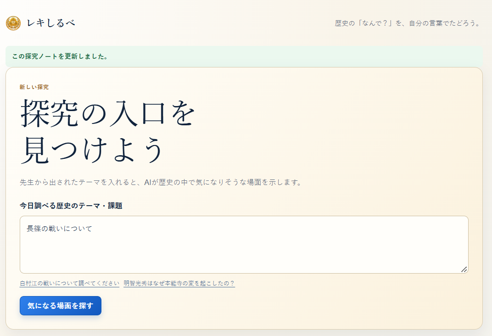
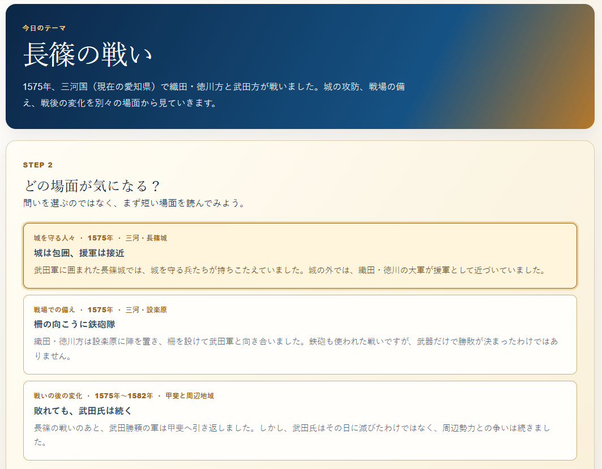
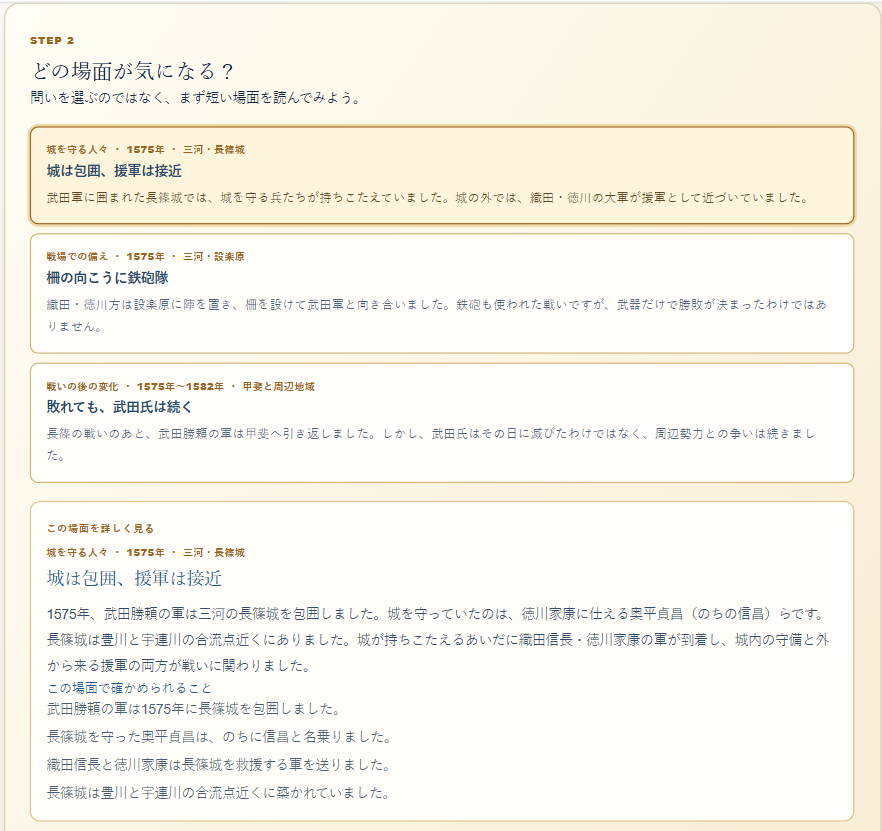
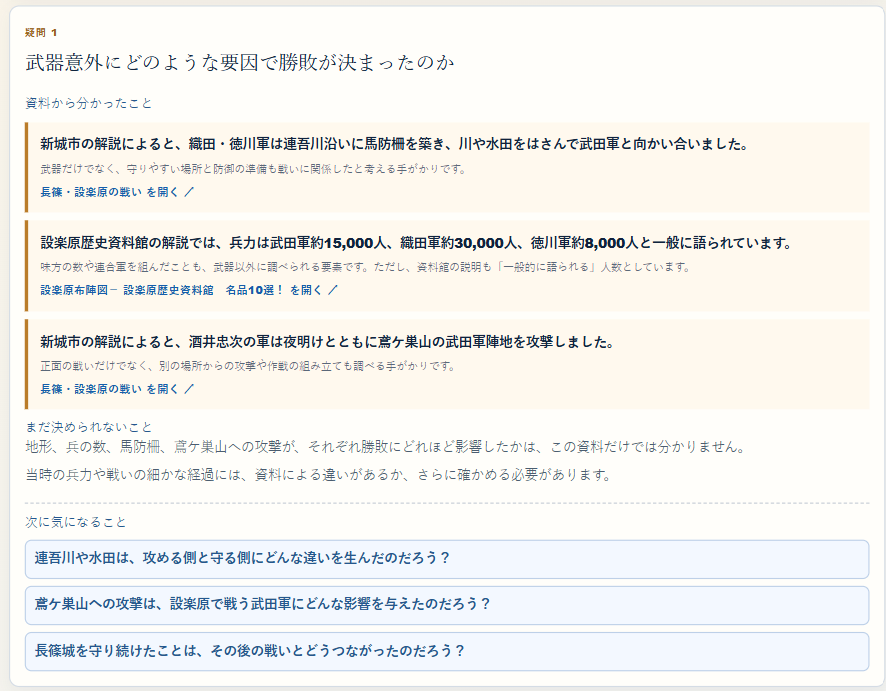
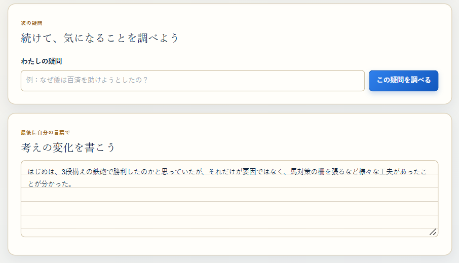

# レキしるべ

> 歴史の「なんで？」を、自分の言葉でたどろう。

[アプリを試す（Vercel）](https://tka-2602.vercel.app/)

レキしるべは、小学校高学年の歴史授業で先生から出された課題を、
「調べて終わり」にせず、自分の疑問から探究するための学習支援アプリです。

## 製品概要

### History × Inquiry Learning

例えば、先生から「長篠の戦いについて調べてください」と課題が出されたとします。
児童は検索や生成AIで概要、登場人物、結果を調べて終わりがちです。しかし、それでは歴史を自分の興味として学ぶ体験にはつながりません。

レキしるべは、AIが最初から答えや問いを与えるのではなく、出来事の中にある驚き・対立・変化・選択を、短い歴史の場面として示します。児童はその場面を読み、自分が気になったことを「なんで？」として書き、資料を根拠に考えを深めます。

## 背景

私たち自身、学校で歴史を学んできました。しかし、歴史は年号や人物、出来事を覚える学習になりやすく、「面白かった」「もっと知りたい」と思える経験は多くありませんでした。

本来、学習はやらされるものではなく、自分の興味に従って深く知っていく楽しい体験であるべきです。そのためには、児童が自分で「気になる」と感じ、その疑問を追いかけられることが重要だと考えました。

一方、授業で「なぜこうなったのだろう」と言われても、何も分からない状態では手が動きません。教科書には多くの事実が限られた紙面に並ぶため、出来事どうしの関係、立場による見え方の違い、前後で何が変わったのかを最初からつかむことは簡単ではありません。

> 疑問は、何も知らない状態から生まれるのではない。
> ある程度の事実や関係を理解したときに見える「空白」から生まれる。

私たちはこの考えから、既にある問いを深掘りするだけでなく、**「なぜ」を考える一段階前にある、理解と違和感の入口**をAIで支えることにしました。

## 想定する利用場面

主な利用者は、小学校高学年で歴史を学ぶ児童です。先生が授業や宿題でテーマを出し、児童はそのテーマについて探究します。

先生にとっては、児童ごとに異なる興味の入口を一人ずつ用意することは難しい課題です。レキしるべは、授業のテーマを置き換えるものではなく、先生が出したテーマから児童の探究を始めやすくする補助線です。

## 体験の流れ

### 1. 先生から出された課題を入れる

児童は、授業で出されたテーマをそのまま入力します。自分でテーマを決められなくても、学校の学習から探究を始められます。



### 2. 答えではなく、「気になる場面」に出会う

AIは「なぜ〜なの？」という問いを直接出しません。長篠の戦いであれば、城を守る人、戦場の備え、戦いの後の変化など、異なる角度の短い場面を示します。

広いテーマでは、時期・場所・立場が一つに偏らないように場面をつくります。児童は、見出しと短い説明を読んで、自分が引っかかった場面を選びます。



### 3. 事実と関係を知り、自分の「なんで？」を見つける

選んだ場面には、少し詳しい背景と確認できる事実を表示します。AIが原因や人物の本心を断定するのではなく、児童が「なぜ城を守り続けられたのだろう」「武器以外に何が勝敗を分けたのだろう」と考えられるだけの足場を渡します。

すでに疑問を持っている児童は、場面を選ばず最初から自分の疑問を書いて調べることもできます。



### 4. 資料カードで根拠を確かめる

疑問を入力すると、AIはWeb検索を行い、公的機関・博物館・図書館・教育機関などを優先して資料カードを作ります。

カードには、資料から分かったこと、その事実が疑問とどう関係するか、出典、まだ決められないことを分けて示します。リンクだけを並べて「根拠を探して」と任せるのではなく、根拠を読むことに集中できる形にしました。



### 5. 次の疑問を重ね、自分の考えの変化を残す

探究は一つの疑問で終わりません。資料カードから生まれた次の疑問を選んだり、自分で書いたりして、考えをつなげていきます。最後に、自分の考えがどのように変わったかを自分の言葉で残します。

AIが感想や結論を代筆しないことで、児童自身の探究の軌跡を守ります。



## レキしるべの特長

### 「なぜ」の一段階前を設計した

既存のChat AIは、すでにある質問に答えたり、質問を深掘りしたりすることに優れています。レキしるべはその前段階、つまり児童が「何が不思議なのか」を見つける過程に焦点を当てています。

### 広いテーマでも視点を偏らせない

第二次世界大戦のような広いテーマでは、暮らしや終戦だけに偏らず、「政治の選択」「国や地域どうしの関係・戦地」「暮らし」「戦後の変化」など、異なる観点を組み合わせて場面を示します。各場面には、角度・時期・場所も表示します。

### 児童の思考をAIが代筆しない

AIは、仮説や感想の完成文を作りません。事実と出典を資料カードとして示し、何を問い、どう考えるかは児童に委ねます。

### 探究を振り返れる

テーマ、場面、自分で書いた疑問、資料カード、考えの変化は「探究ノート」としてブラウザ内に保存されます。過去のノートを開き、問いの連なりを振り返れます。

## 開発で工夫した点

### 生成結果を「探究の入口」として構造化した

自由な文章を生成するだけでは、きっかけが短すぎたり、広いテーマで同じ観点に偏ったりします。そのため、AIの出力を以下の項目に構造化しました。

- 場面のタイトル
- 見る角度・時期・場所
- 選択前に読む短い場面
- 選択後に読む詳しい背景
- 確認できる事実

### 資料の探索と児童の思考を分離した

資料カードでは、出典と確認できる事実をAIが整理します。一方、問いの選択、資料の解釈、考えの変化は児童自身が担います。AIが便利すぎることで探究の主体が失われないよう、役割を分けました。

## 使用技術

- Next.js 16 / React / TypeScript
- OpenAI Responses API
  - Structured Outputs：場面と資料カードを一定の形式で生成
  - Web Search：資料カードの出典探索
- localStorage：探究ノートの端末内保存
- Vercel：デプロイ

## 今後の展望

- 教員がテーマや学年に応じて、場面の難易度や観点を調整できる機能
- 出典の信頼性・読みやすさをより細かく確認する機能
- 探究ノートを授業内で提出・共有する機能
- 児童の問いの広がりを、先生が振り返りに活用できる機能

## 開発者向け：ローカルでの起動

```bash
npm install
Copy-Item .env.example .env.local
npm run dev
```

`.env.local` にOpenAI APIキーを設定してください。

```env
OPENAI_API_KEY=your_api_key
OPENAI_MODEL=gpt-6-luna
```

APIキーはサーバー側のRoute Handlerだけで使われ、ブラウザやGitHubには送信されません。

## 保存について

画面右上の「ブラウザに保存」を押すと、探究ノートが端末のブラウザ内に保存されます。サーバーやGitHubへ送信されることはありません。ブラウザのサイトデータを削除した場合、別の端末・ブラウザでは復元できません。
